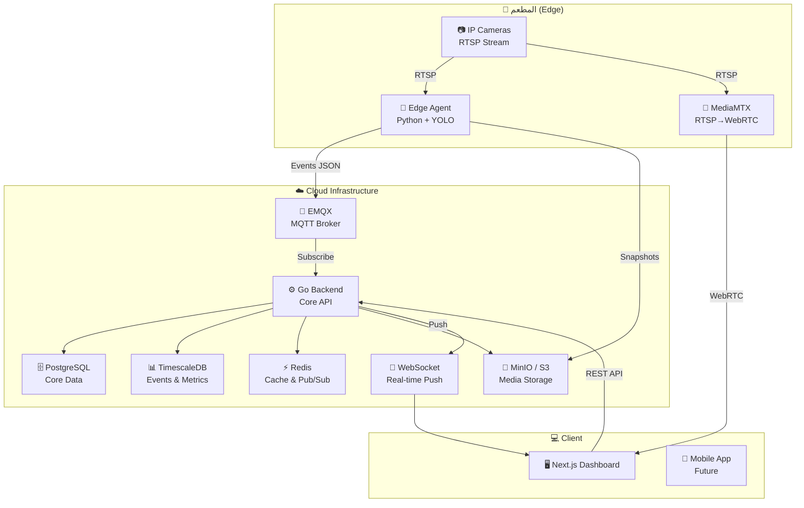
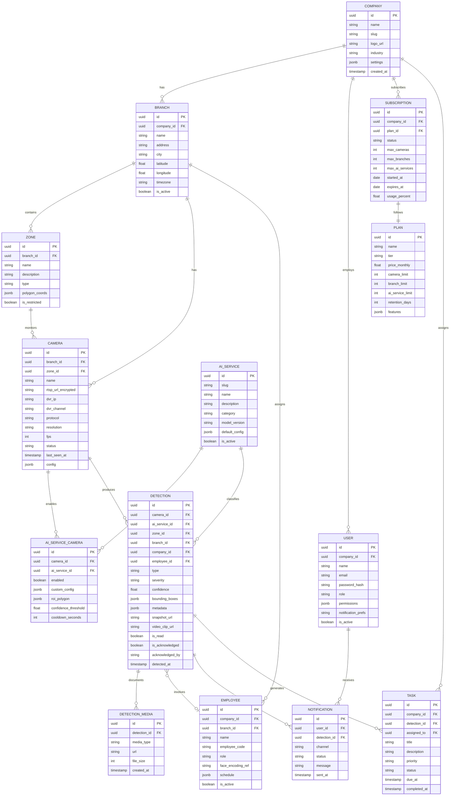
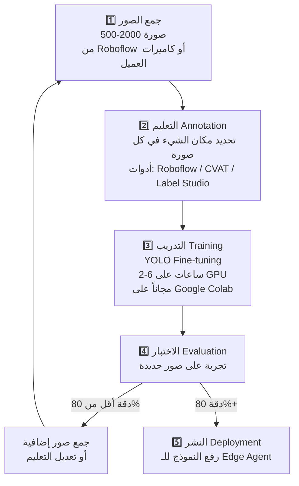
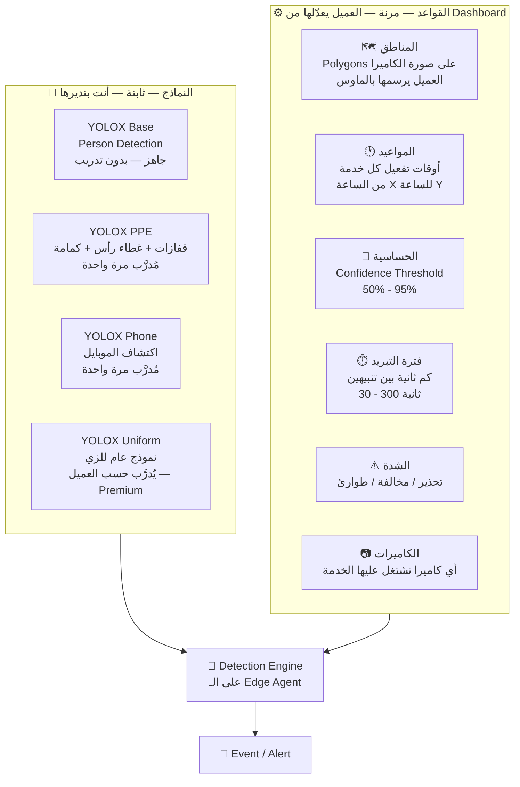
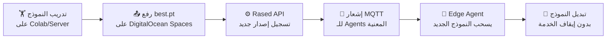
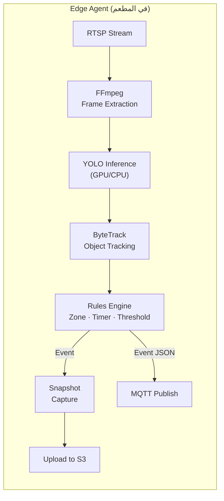
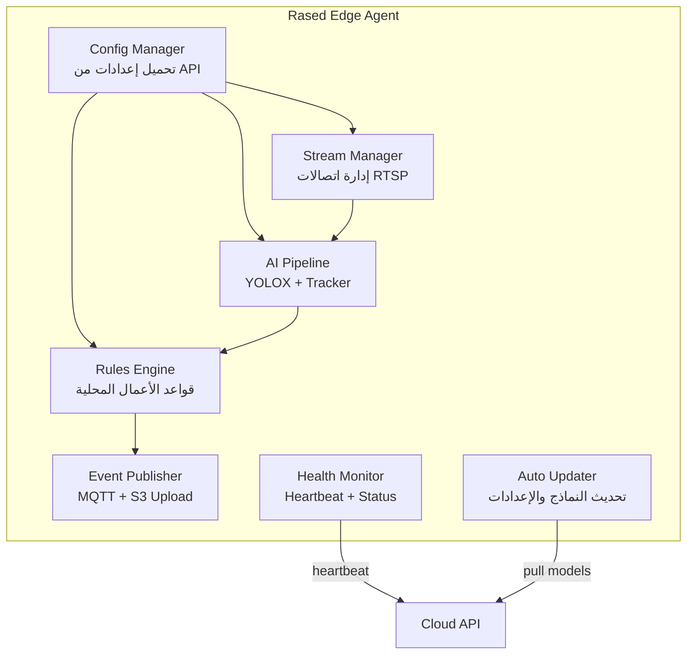
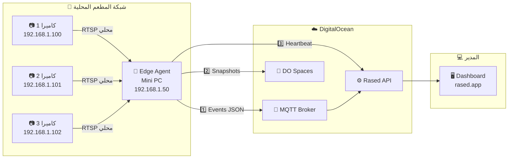
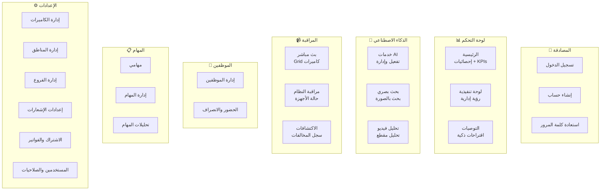
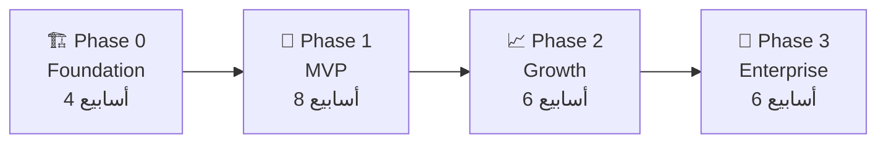

# 🏗️ خطة بناء مشروع "رَاصِد" — AI Monitoring SaaS

## المحتويات

- [1. ملخص المشروع](#1-ملخص-المشروع)
- [2. تحليل منصة Rgeeb من الصور](#2-تحليل-منصة-rgeeb-من-الصور)
- [3. المعمارية التقنية المقترحة](#3-المعمارية-التقنية-المقترحة)
- [4. هيكل قاعدة البيانات](#4-هيكل-قاعدة-البيانات)
- [5. خدمات الذكاء الاصطناعي](#5-خدمات-الذكاء-الاصطناعي) ← أنواع الاكتشافات · التدريب · التخصيص لكل عميل
- [6. تصميم الـ Edge Agent](#6-تصميم-الـ-edge-agent) ← الاتصال بالكاميرات · BYOD · التثبيت
- [7. واجهة المستخدم والصفحات](#7-واجهة-المستخدم-والصفحات)
- [8. خطة التنفيذ المرحلية](#8-خطة-التنفيذ-المرحلية)
- [9. التسعير والتشغيل](#9-التسعير-والتشغيل)
- [10. المخاطر والتحديات](#10-المخاطر-والتحديات)
- [هيكل المشروع (Monorepo)](#هيكل-المشروع-المقترح-monorepo)
- [11. استراتيجية المطور الواحد](#11-استراتيجية-المطور-الواحد-solo-developer-strategy)

---

## 1. ملخص المشروع

| البند | التفاصيل |
|---|---|
| **اسم المنتج** | رَاصِد (Rased) — AI Monitoring SaaS |
| **السوق المستهدف** | مطاعم → مصانع → مراكز تجارية (مصر أولاً) |
| **نموذج العمل** | اشتراك شهري B2B — سعر لكل كاميرا أو لكل فرع |
| **القيمة الأساسية** | تحويل كاميرات المراقبة الموجودة إلى أداة ذكاء اصطناعي لمراقبة العمليات والامتثال |
| **المنهج التقني** | Microservices مفتوحة المصدر + Edge Processing محلي |
| **Cloud Provider** | DigitalOcean |
| **Edge Hardware** | BYOD — العميل يوفر الجهاز المحلي |
| **الفريق** | مطور واحد (Solo Developer) |
| **التقنيات الأساسية** | Next.js · Go · Python/FastAPI · PostgreSQL · TimescaleDB · Redis · MediaMTX · MQTT · YOLO |

> [!IMPORTANT]
> المشروع لا يهدف لاستنساخ Rgeeb حرفياً — الهدف فهم الوظائف وتدفق البيانات وبناء منتج مستقل باسم **رَاصِد** بنفس القدرات التجارية، قابل للتوسع من المطاعم للمصانع والمراكز التجارية.

---

## 2. تحليل منصة Rgeeb من الصور

### 2.1 لوحة التحكم الرئيسية (Dashboard)


**العناصر المستخرجة:**

| العنصر | القيمة | الملاحظة |
|---|---|---|
| اسم العميل | FIT FOR LESS | Multi-tenant — كل عميل له حساب منفصل |
| الكاميرات | 7/7 | عدد الكاميرات المتصلة من إجمالي المسجلة |
| خدمات الذكاء | 69 | عدد خدمات AI النشطة |
| حالات الكشف | 833 | إجمالي الاكتشافات |
| غير مقروءة | 19,214 | أحداث لم تُراجع بعد |
| نوع الحساب | Trial | نظام اشتراكات بفترة تجريبية |
| تاريخ انتهاء | 5 ديسمبر 2026 | مدة تجريبية محددة |
| استهلاك | 42% | مؤشر استهلاك حصة الخطة |

**خصائص مكتشفة:**
- ✅ دليل إعداد وتشغيل سريع (Quick Setup Wizard) — 5 خطوات
- ✅ ربط كاميرات ميدانية عبر RTSP
- ✅ إنشاء فروع ومواقع
- ✅ تفعيل خدمات الذكاء الاصطناعي
- ✅ تفعيل الإشعارات وقنوات التنبيه
- ✅ ضبط قواعد الإسناد التلقائي للمهام
- ✅ مركز إجراءات ذات أولوية (Priority Actions Center)
- ✅ فلاتر التاريخ والفترة الزمنية
- ✅ أوضاع عرض متعددة (جدول / بطاقات / Timeline)

### 2.2 البث المباشر للكاميرات (Live Feeds)


**العناصر المستخرجة:**

| العنصر | التفاصيل |
|---|---|
| عنوان الصفحة | البث المباشر للكاميرات — راقب الكاميرات في الوقت الحقيقي |
| عدد الكاميرات | 7 كاميرا |
| اسم الكاميرات | Fit 4 Less 4, 5, 6... (تسمية حرة) |
| المنطقة | Zone 1 |
| مصدر الكاميرا | DVR-192.168.8.234 — CH8, CH13, CH18 |
| الحالة | "منشطة" (Active) بلون أخضر |
| الحالة البديلة | "Pause" عندما لا يوجد بث |
| الفلاتر | تجميع حسب المنطقة + سجل الدوار |

**ملاحظات هندسية:**
- الكاميرات مربوطة عبر DVR واحد بعنوان IP محلي (`192.168.8.234`)
- كل كاميرا = Channel في الـ DVR (CH8, CH13, CH18)
- يوجد تقسيم بالمناطق (Zones) — كل كاميرا مرتبطة بمنطقة
- البث يظهر في Grid قابل للتعديل
- الكاميرات المرتبطة بالعميل والفرع (Fit For Less → Zone 1)

### 2.3 سجل الاكتشافات (Detections Log)


**العناصر المستخرجة:**

| العنصر | التفاصيل |
|---|---|
| عنوان الصفحة | سجل الاكتشافات — سجل الرصد الموحد لجميع المخالفات وأحداث الذكاء الاصطناعي مع التوثيق المصور |
| إجمالي الاكتشافات | 842 نتيجة + 89 حالة + خطيرة |
| Filters | الفرع · الخدمة · الكاميرا · المنطقة · نطاق التاريخ · بحث نصي |

**أنواع الاكتشافات المرئية:**

| النوع | الوصف | Confidence |
|---|---|---|
| التسكع (Loitering) | شخص في مكان لفترة أطول من المسموح | 100% |
| مراقبة معدات السلامة في المطبخ | PPE Detection | 100% |
| عدم ارتداء غطاء الرأس | Head Cover Compliance | ظاهر |
| عدم ارتداء القفاز الرسمي | Glove Compliance | ظاهر |

**ملاحظات هندسية:**
- كل اكتشاف مصحوب بـ **صورة توثيقية** (Snapshot) مع Bounding Boxes ملونة
- تظهر **نسبة الثقة** (Confidence Score) — 100% في الأمثلة
- معلومات ثابتة لكل اكتشاف: اسم الكاميرا · الفرع · المنطقة · الوقت
- الصور تُعرض في **Grid من البطاقات** مع أيقونات ملخصة
- وجود أيقونات أسفل كل بطاقة (👤 أشخاص مكتشفون)
- التاريخ والوقت بدقة الدقيقة (07:35, 07:36, 07:37)

### 2.4 مركز خدمات الذكاء الاصطناعي (AI Services Center)


**الخدمات المكتشفة:**

| الخدمة | عدد الاكتشافات | الحالة |
|---|---|---|
| 🟢 كشف التسكع (Loitering Detection) | 353 | نشط |
| 🟣 كشف استخدام الموبايل (Phone Detection) | 8 حالات / 4 خدمات | نشط |
| 🔴 سلامة المطبخ PPE (Kitchen Safety) | 438 | نشط |
| 🔵 التصفيل المنتظر (Queue/Wait Detection) | 44 | نشط |
| 🟢 مراقبة الموظفين (Employee Monitoring) | 5 | نشط |

**إحصائيات مجمعة (شريط علوي):**
- النشطة: 17 | ساعات: 69 | تحليلات: 13 | عمليات: 28 | مراقبة: 9 | الكل: 11

### 2.5 القائمة الجانبية الكاملة (Full Sidebar Navigation)

```
لوحة التحكم
├── لوحة التحكم (Dashboard)
├── لوحة الأعمال التنفيذية (Executive Dashboard)
├── التوصيات (Recommendations)
│
├── مركز الذكاء الاصطناعي
│   └── خدمات الذكاء الاصطناعي (AI Services)
│
├── المراقبة والاكتشافات
│   ├── البث المباشر (Live Feeds)
│   ├── مراقبة النظام (System Monitoring)
│   └── الاكتشافات (Detections)
│
├── الإشعارات (Notifications)
├── إعدادات الإشعارات (Notification Settings)
├── سجل رسائل تيليجرام (Telegram Log)
│
├── الكتروبات (?)
│
├── البحث البصري بالذكاء الاصطناعي (AI Visual Search)
├── تحليل الفيديو (Video Analysis)
├── الحضور والانصراف (Attendance)
│
├── إدارة المهام
│   ├── مهامي (My Tasks)
│   ├── إدارة المهام (Task Management)
│   ├── الداني (?)
│   └── تحليلات المهام (Task Analytics)
│
└── الأنظمة والجداول (Systems & Schedules)
```

---

## 3. المعمارية التقنية المقترحة

### 3.1 مخطط المعمارية العام



### 3.2 تقسيم الخدمات (Microservices)

| الخدمة | اللغة | المسؤولية |
|---|---|---|
| **rased-api** | Go | الـ Core Backend — REST API, Auth, Business Logic, Multi-tenancy |
| **rased-ai** | Python | معالجة الفيديو والتحليل بالذكاء الاصطناعي (YOLOX + Trackers) |
| **rased-edge** | Python | الـ Agent المحلي في المطعم — يسحب RTSP، يحلل، يبعت Events |
| **rased-media** | Go | إدارة البث (MediaMTX proxy)، تسجيل المقاطع، رفع Snapshots |
| **rased-web** | TypeScript | Next.js Dashboard — واجهة العميل |
| **rased-notify** | Go | إدارة الإشعارات (Telegram, WhatsApp, Email, Push) |

### 3.3 الـ Tech Stack الكامل

| الطبقة | التقنية | الغرض |
|---|---|---|
| **Frontend** | Next.js 15 + React 19 | SPA/SSR Dashboard |
| **UI Components** | shadcn/ui + Radix UI + Tailwind CSS 4 | مكونات واجهة حديثة |
| **Charts** | Recharts أو Tremor | رسوم بيانية وتقارير |
| **Video Player** | WebRTC (native) + hls.js | عرض البث المباشر |
| **Backend API** | Go (Gin أو Fiber) | REST API عالي الأداء |
| **AI Engine** | Python 3.12 + FastAPI | Inference Server |
| **Object Detection** | YOLOX (Apache 2.0) | كشف الأشخاص والأشياء — ترخيص تجاري حر |
| **Object Tracking** | ByteTrack / BoT-SORT | تتبع وعد الأشخاص |
| **Video Processing** | FFmpeg + OpenCV | استخراج Frames وتسجيل المقاطع |
| **Media Server** | MediaMTX | RTSP → WebRTC/HLS |
| **IoT Messaging** | EMQX (أو Mosquitto) | MQTT Broker |
| **Primary DB** | PostgreSQL 17 | بيانات الأعمال |
| **Time-Series DB** | TimescaleDB | أحداث وإحصائيات |
| **Cache** | Redis 7 | Caching + Pub/Sub |
| **Object Storage** | MinIO | صور وفيديو المخالفات |
| **Auth** | JWT + OAuth2 (self-hosted) | مصادقة وصلاحيات |
| **Containerization** | Docker + Docker Compose | نشر موحد |
| **Orchestration** | Docker Swarm أو K3s | إنتاج |

---

## 4. هيكل قاعدة البيانات

### 4.1 مخطط العلاقات (ERD)



### 4.2 TimescaleDB — جداول الأحداث الزمنية

```sql
-- أحداث الاكتشافات (Hypertable)
CREATE TABLE detection_events (
    time        TIMESTAMPTZ NOT NULL,
    company_id  UUID NOT NULL,
    branch_id   UUID NOT NULL,
    camera_id   UUID NOT NULL,
    service_slug TEXT NOT NULL,
    severity    TEXT,
    confidence  FLOAT,
    person_count INT,
    metadata    JSONB
);
SELECT create_hypertable('detection_events', 'time');

-- إحصائيات الكاميرات (Continuous Aggregate)
CREATE MATERIALIZED VIEW camera_hourly_stats
WITH (timescaledb.continuous) AS
SELECT
    time_bucket('1 hour', time) AS bucket,
    company_id, branch_id, camera_id,
    COUNT(*) AS total_detections,
    AVG(confidence) AS avg_confidence,
    SUM(person_count) AS total_persons
FROM detection_events
GROUP BY bucket, company_id, branch_id, camera_id;

-- عدد الزوار (Hypertable)
CREATE TABLE visitor_counts (
    time       TIMESTAMPTZ NOT NULL,
    branch_id  UUID NOT NULL,
    camera_id  UUID NOT NULL,
    zone_id    UUID,
    entered    INT DEFAULT 0,
    exited     INT DEFAULT 0,
    occupancy  INT DEFAULT 0
);
SELECT create_hypertable('visitor_counts', 'time');
```

---

## 5. خدمات الذكاء الاصطناعي

### 5.1 الخدمات المطلوبة (مستوحاة من تحليل Rgeeb)

| # | الخدمة | الوصف | نموذج الـ AI | الأولوية |
|---|---|---|---|---|
| 1 | **Visitor Counting** | عد الداخلين والخارجين بخط عد | YOLOX + ByteTrack + Line Counter | 🔴 MVP |
| 2 | **Loitering Detection** | كشف التسكع — شخص في منطقة أطول من المسموح | YOLOX + Tracker + Dwell Timer | 🔴 MVP |
| 3 | **PPE / Kitchen Safety** | كشف عدم ارتداء معدات السلامة (قفازات، غطاء رأس) | YOLOX Fine-tuned | 🔴 MVP |
| 4 | **Phone Usage Detection** | كشف استخدام الموبايل أثناء العمل | YOLOX Fine-tuned | 🟡 P1 |
| 5 | **Employee Monitoring** | مراقبة تواجد الموظفين في مناطقهم | YOLOX + Zone Mapping | 🟡 P1 |
| 6 | **Queue/Wait Detection** | قياس وقت الانتظار في الطوابير | YOLOX + Tracker + Timer | 🟡 P1 |
| 7 | **Uniform Compliance** | التحقق من الزي الرسمي | YOLOX Fine-tuned | 🟢 P2 |
| 8 | **Cleanliness Monitoring** | مراقبة نظافة المناطق | Custom Model | 🟢 P2 |

### 5.2 كيف يعمل الاكتشاف — الأساس التقني

نموذج YOLO بيستقبل صورة (فريم من الفيديو) ويرجع قائمة بكل الأشياء المكتشفة ومكانها:

```
فريم فيديو (صورة) ──→ YOLO ──→ قائمة الأشياء المكتشفة + إحداثياتها + نسبة الثقة
```

مثال — فريم واحد من كاميرا مطبخ:

```json
[
  {"label": "person",   "confidence": 0.95, "box": [120, 80, 280, 400]},
  {"label": "phone",    "confidence": 0.88, "box": [200, 150, 240, 200]},
  {"label": "no_gloves","confidence": 0.82, "box": [140, 300, 180, 340]}
]
```

### 5.3 الثلاث أنواع من الاكتشافات

> [!IMPORTANT]
> مش كل الاكتشافات متساوية — فيه 3 أنواع مختلفة تماماً في طريقة العمل والجهد المطلوب.

#### النوع 1: اكتشاف بنموذج YOLO الجاهز (بدون أي تدريب)

YOLOX الأساسي من Ultralytics بيكتشف 80 نوع شيء من أول يوم (شخص، موبايل، كرسي، لابتوب...). الاكتشافات دي بتعتمد على **قواعد عمل (Rules)** فوق الاكتشاف الأساسي:

| الاكتشاف | إزاي بيشتغل؟ | تدريب مطلوب؟ |
|---|---|---|
| **عد الزوار** | YOLOX يكتشف "person" + Tracker يديله ID + خط عد يحسب الداخل والخارج | ❌ لا |
| **التسكع** | YOLOX يكتشف "person" + Tracker يحسب المدة اللي قعدها في منطقة معينة | ❌ لا |
| **الازدحام** | YOLOX يعد عدد الأشخاص في منطقة محددة | ❌ لا |
| **موظف خارج منطقته** | YOLOX يكتشف "person" + نشوف هل هو جوا الـ Zone المحدد ولا لأ | ❌ لا |
| **منطقة محظورة** | "person" دخل Polygon محظور = مخالفة فورية | ❌ لا |
| **وقت الانتظار** | Tracker يحسب مدة وقوف كل شخص في منطقة الطابور | ❌ لا |

#### النوع 2: اكتشاف بنموذج YOLO مُدرَّب (Fine-tuned)

الاكتشافات دي محتاجة تدريب النموذج على صور جديدة لأن YOLOX الأساسي مش بيعرفها:

| الاكتشاف | ليه محتاج تدريب؟ | مصدر بيانات التدريب |
|---|---|---|
| **القفازات** | YOLOX الأساسي مش بيفرق بين يد بقفاز ويد من غيره | Roboflow Universe (مجاني) |
| **غطاء الرأس** | محتاج يتعلم شكل غطاء رأس المطبخ | Roboflow Universe (مجاني) |
| **الكمامة** | محتاج يفرق بين وش بكمامة ووش من غيرها | Roboflow Universe (مجاني) |
| **استخدام الموبايل** | محتاج يكتشف موبايل في يد الشخص (أدق من كشف موبايل عادي) | Roboflow Universe (مجاني) |
| **الزي الرسمي** | كل مطعم ليه زي مختلف | صور من كاميرات العميل |

#### النوع 3: قواعد عمل بدون AI إضافي

ده مجرد شروط برمجية (if/else) بتتطبق على نتائج الاكتشاف:

| القاعدة | المنطق |
|---|---|
| **وقت التفعيل** | مخالفة بس لو بين الساعة 9ص و 11م مثلاً |
| **حد الشدة** | لو Confidence أقل من 75% ما نسجلش المخالفة |
| **فترة التبريد** | ما نبعتش تنبيه تاني لنفس المخالفة قبل 60 ثانية |
| **تصعيد** | لو المخالفة اتكررت 3 مرات في ساعة → تتحول من "تحذير" لـ "خطيرة" |

### 5.4 مصادر بيانات التدريب (مجانية)

```
مصادر مجانية (للبداية — تكفي للـ MVP):
├── Roboflow Universe         → آلاف الـ Datasets جاهزة ومجانية
│   ├── "PPE Detection"       → 10,000+ صورة معدات سلامة
│   ├── "Phone Detection"     → 5,000+ صورة استخدام موبايل
│   ├── "Gloves Detection"    → 3,000+ صورة قفازات
│   ├── "Hard Hat"            → 8,000+ صورة غطاء رأس
│   └── "Face Mask"           → 7,000+ صورة كمامات
│
مصادر من العميل (لتحسين الدقة):
└── كاميرات المطعم نفسه      → صور حقيقية من بيئة العمل
```

> [!TIP]
> **Roboflow Universe** فيه datasets جاهزة مجانية لأغلب الاستخدامات — ده هيوفر عليك 80% من وقت جمع البيانات. تقدر تبدأ بيها وبعدين تحسّن الدقة بصور حقيقية من المطعم.

### 5.5 عملية التدريب خطوة بخطوة



#### كود التدريب (YOLOX):

```python
# تدريب YOLOX على dataset مخصص
# 1. تحضير البيانات بتنسيق COCO
# 2. إنشاء ملف Experiment

import os
from yolox.exp import Exp as MyExp

class GlovesExp(MyExp):
    def __init__(self):
        super().__init__()
        self.num_classes = 2  # gloves, no_gloves
        self.depth = 0.33     # YOLOX-S
        self.width = 0.50
        self.input_size = (640, 640)
        self.max_epoch = 100
        self.data_dir = "datasets/gloves"
        self.train_ann = "train.json"
        self.val_ann = "val.json"

# التدريب من سطر الأوامر:
# python -m yolox.tools.train -f gloves_exp.py -d 1 -b 16 --fp16 -c yolox_s.pth
#
# النتيجة: best_ckpt.pth ← ده النموذج الجديد بيتنقل للـ Edge Agent
```

**لماذا YOLOX وليس Ultralytics YOLO؟**

| المقارنة | YOLOX | Ultralytics YOLOv8 |
|---|---|---|
| **الترخيص** | ✅ Apache 2.0 (تجاري حر) | ⚠️ AGPL-3.0 (لازم تفتح كودك أو تشتري رخصة) |
| **الأداء** | ممتاز — مناسب للـ Edge | ممتاز |
| **التكلفة التجارية** | \$0 | \$1,950+/سنة للرخصة التجارية |
| **الأجهزة الضعيفة** | مُحسَّن للـ Edge devices | جيد لكن أثقل |
| **ByteTrack** | مصمم أصلاً لـ YOLOX | يحتاج تعديل |

**أين يتم التدريب:**
- **Google Colab مجاناً** — GPU T4 مجاني يكفي لتدريب نموذج في 2-4 ساعات
- **جهازك لو فيه NVIDIA GPU** — أسرع ومن غير حدود وقت
- **DigitalOcean GPU Droplet** — للإنتاج والتدريب المتكرر

#### أدوات التعليم (Labeling) المجانية:

| الأداة | النوع | الأفضل لـ |
|---|---|---|
| **Roboflow** (Free tier) | في المتصفح | أسهل واحدة — السحب والإفلات |
| **CVAT** | مفتوح المصدر | مشاريع كبيرة ومعقدة |
| **Label Studio** | مفتوح المصدر | مرونة عالية |

### 5.6 تخصيص الاكتشافات لكل عميل

> [!IMPORTANT]
> **مش هتدرب نموذج لكل مطعم من الصفر.** أنت عندك 5-6 نماذج عامة بتشتغل على كل المطاعم. العميل بيخصص التجربة عن طريق **القواعد** (المناطق، المواعيد، الحساسية) مش عن طريق تدريب نموذج جديد. التدريب المخصص بيبقى خدمة Premium لعملاء كبار بس.

#### التصميم: طبقتين منفصلتين



#### مثال عملي — مطعمين مختلفين بنفس النماذج:

**مطعم "برجر كينج"** عايز:

```
✅ كشف القفازات    → في المطبخ بس (Zone: Kitchen) → حساسية 75%
✅ كشف الموبايل    → طول اليوم → في كل المناطق
✅ عد الزوار        → على كاميرا الباب → خط عد مرسوم
✅ كشف التسكع      → في الممر → لو حد قعد أكتر من 3 دقائق
❌ كشف الزي        → مش مفعّل
```

**مطعم "الطازج"** عايز:

```
✅ كشف غطاء الرأس  → في كل المطعم → حساسية 80%
✅ كشف القفازات    → في منطقة التحضير بس
✅ عد الزوار        → على كاميرا الباب
❌ كشف الموبايل    → مش مفعّل
❌ كشف التسكع      → مش مفعّل
```

**نفس النماذج، إعدادات مختلفة بالكامل.** كل ده بيتعمل من Dashboard بدون أي كود.

#### في الـ Dashboard ده هيظهر إزاي:

```
صفحة "خدمات الذكاء الاصطناعي" لكل عميل:
┌──────────────────────────────────────────────────────────┐
│  🟢 عد الزوار              [مفعّل]                       │
│     → الكاميرات: كاميرا الباب الرئيسي                  │
│     → خط العد: [ارسم على الصورة]                       │
│                                                          │
│  🟢 كشف القفازات           [مفعّل]                       │
│     → الكاميرات: كاميرا المطبخ                         │
│     → المنطقة: [ارسم Polygon على الصورة]               │
│     → الحساسية: ████████░░ 75%                          │
│     → التبريد: 60 ثانية                                 │
│     → أوقات التفعيل: 8:00 ص — 12:00 م                  │
│     → الشدة: مخالفة                                     │
│                                                          │
│  🔴 كشف الموبايل           [معطّل]                       │
│                                                          │
│  🟢 كشف التسكع             [مفعّل]                       │
│     → الكاميرات: كاميرا الممر                          │
│     → المنطقة: [ارسم Polygon على الصورة]               │
│     → الحد الأقصى للبقاء: 180 ثانية                    │
│     → الشدة: تحذير                                      │
└──────────────────────────────────────────────────────────┘
```

### 5.7 خطة بناء النماذج (الجدول الزمني)

| المرحلة | النموذج | مصدر البيانات | الجهد المطلوب | التكلفة |
|---|---|---|---|---|
| **MVP (الشهر 2)** | Person Detection + Tracking | YOLOX جاهز — بدون تدريب | 0 | مجاناً |
| **MVP (الشهر 2)** | Loitering | قواعد عمل فوق Person Detection | قليل | مجاناً |
| **الشهر 4** | Phone Detection | Dataset من Roboflow + Fine-tune | يوم واحد | مجاناً (Colab) |
| **الشهر 4** | PPE (قفاز + غطاء رأس + كمامة) | Dataset من Roboflow + Fine-tune | يوم واحد | مجاناً (Colab) |
| **الشهر 5** | Uniform Detection (عام) | صور من أول عميل + Fine-tune | أسبوع | مجاناً (Colab) |
| **لاحقاً** | نموذج مخصص لعميل Enterprise | صور من كاميرات العميل | حسب الطلب | خدمة Premium |

### 5.8 آلية تحديث النماذج على الـ Edge Agent



الـ Edge Agent بيفحص التحديثات بشكل دوري (كل ساعة مثلاً). لما يلاقي إصدار جديد من نموذج، بينزله في الخلفية وبيبدله بدون إيقاف التحليل.

### 5.9 معمارية خدمة الـ AI على الـ Edge Agent



### 5.10 بنية الـ Event JSON

```json
{
  "event_id": "evt_abc123",
  "agent_id": "agent_branch_001",
  "camera_id": "cam_uuid",
  "service": "loitering_detection",
  "severity": "high",
  "confidence": 0.97,
  "detected_at": "2026-11-17T18:35:22Z",
  "bounding_boxes": [
    {"x1": 120, "y1": 80, "x2": 280, "y2": 350, "label": "person", "track_id": 7}
  ],
  "zone": "kitchen",
  "duration_seconds": 185,
  "snapshot_key": "detections/2026/11/17/evt_abc123.jpg",
  "metadata": {
    "person_count": 1,
    "rule_violated": "max_dwell_120s",
    "frame_number": 45230
  }
}
```

---

## 6. تصميم الـ Edge Agent

### 6.1 مكونات الـ Agent



### 6.2 دورة حياة الـ Agent

```
1. التشغيل → يقرأ ملف الإعدادات المحلي
2. الاتصال → يتصل بـ MQTT Broker ويسجل نفسه
3. التزامن → يسحب آخر إعدادات الكاميرات والخدمات من API
4. البث → يفتح اتصالات RTSP مع الكاميرات المسجلة
5. التحليل → يمرر الفريمات على YOLO كل N ثانية
6. الأحداث → عند اكتشاف مخالفة، يلتقط Snapshot ويبعت Event
7. النبض → كل 30 ثانية يبعت Heartbeat للـ API
8. إعادة الاتصال → عند انقطاع الإنترنت، يخزن Events محلياً ويبعتها لما يرجع
9. التحديث → يفحص تحديثات النماذج والإعدادات بشكل دوري
```

### 6.3 متطلبات الهاردوير في المطعم (BYOD — العميل يوفره)

> [!IMPORTANT]
> العميل هو المسؤول عن توفير الجهاز. أنت بتقدمله قائمة المتطلبات ودليل التثبيت، وبتبيعله الاشتراك في البرمجيات فقط.

| المكون | الحد الأدنى | المُوصى |
|---|---|---|
| **الجهاز** | Mini PC (Intel N100) | Mini PC مع GPU (NVIDIA Jetson) |
| **المعالج** | 4 cores | 6+ cores |
| **الرام** | 8 GB | 16 GB |
| **التخزين** | 128 GB SSD | 256 GB SSD |
| **GPU** | Intel iGPU (بطيء) | NVIDIA Jetson Orin Nano / RTX GPU |
| **الشبكة** | Ethernet 100Mbps | Gigabit Ethernet |
| **الكاميرات** | حتى 4 بدون GPU | حتى 16+ مع GPU |

> [!TIP]
> بدون GPU مخصص، الـ YOLO هيشتغل على CPU وهيقدر يحلل 2-5 FPS لكل كاميرا. مع NVIDIA Jetson Orin Nano، تقدر توصل لـ 15-30 FPS لكل كاميرا.

### 6.4 كيف الموقع بيتصل بالكاميرات — المعمارية الكاملة

> [!IMPORTANT]
> الموقع (Dashboard) **مستحيل** يوصل للكاميرات مباشرة. الكاميرات على شبكة محلية (LAN) والسيرفر على الإنترنت. الـ **Edge Agent** هو الوسيط الوحيد بينهم.



**المسارات الثلاثة:**

| المسار | ماذا ينقل | الحجم | التوقيت |
|---|---|---|---|
| **Events JSON** | بيانات المخالفة (نوع، ثقة، إحداثيات) | كيلوبايتات | لحظي عبر MQTT |
| **Snapshots** | صورة المخالفة مع Bounding Boxes | 50-200 KB | عند كل مخالفة |
| **Heartbeat** | حالة الـ Agent والكاميرات | بايتات | كل 30 ثانية |

**البث المباشر (Live View)** — مسار منفصل عند الطلب فقط:

```
كاميرا (RTSP) → Agent (يحول RTSP→WebRTC عبر MediaMTX) → Relay → متصفح المدير
```

ده بيحصل **عند الطلب بس** — لما المدير يفتح صفحة البث المباشر، مش 24/7.

### 6.5 تثبيت الـ Agent عند العميل (BYOD)

العميل بيوفر الجهاز، وأنت بتقدمله:

| ما تقدمه | التفاصيل |
|---|---|
| **Docker Image** | جاهز فيه الـ Edge Agent وكل الاعتماديات |
| **دليل تثبيت** | صفحة ويب بسيطة بالخطوات |
| **رابط تفعيل** | Token من الـ Dashboard يربط الجهاز بحساب العميل |
| **قائمة متطلبات** | مواصفات الجهاز الموصى بها |

**أمر التثبيت — سطر واحد:**

```bash
curl -sSL https://rased.app/install.sh | bash
# أو مباشرة بـ Docker
docker run -d --name rased-agent \
  -e AGENT_TOKEN="xxxxx-xxxxx-xxxxx" \
  --restart unless-stopped \
  rased/edge-agent:latest
```

**خطوات التفعيل من الـ Dashboard:**

```
1. العميل يدخل Dashboard → إعدادات → الأجهزة → "إضافة جهاز جديد"
2. النظام يولّد Token فريد
3. العميل يشغّل أمر التثبيت على الجهاز المحلي مع الـ Token
4. الـ Agent يسجل نفسه ويظهر في Dashboard بحالة "متصل" ✅
5. العميل يضيف الكاميرات (عنوان IP المحلي + المنفذ + بيانات الدخول)
6. الـ Agent يتحقق من اتصال الكاميرا ويبدأ التحليل
```

### 6.6 ماذا يحدث في السيناريوهات الحرجة

| السيناريو | سلوك الـ Agent |
|---|---|
| **انقطاع الإنترنت** | يستمر في التحليل + يخزن Events محلياً + يبعتها لما الإنترنت يرجع |
| **كاميرا تقفل** | يعيد المحاولة كل 30 ثانية + يبعت تنبيه "كاميرا غير متصلة" |
| **الجهاز يعيد التشغيل** | Docker restart policy يشغله تلقائياً |
| **تحديث نموذج AI** | يسحب النموذج الجديد في الخلفية ويبدله بدون توقف |
| **إعدادات جديدة من Dashboard** | يستقبلها عبر MQTT ويطبقها فوراً |

---

## 7. واجهة المستخدم والصفحات

### 7.1 خريطة الصفحات الكاملة



### 7.2 تفاصيل كل صفحة رئيسية

#### لوحة التحكم (Dashboard)
| المكون | النوع | الوظيفة |
|---|---|---|
| Welcome Banner | Hero Card | رسالة ترحيب + إحصائيات مجمعة |
| KPI Cards | Stat Cards (4) | كاميرات · خدمات AI · اكتشافات · غير مقروء |
| Trial Bar | Progress Bar | حالة الاشتراك + تاريخ الانتهاء + نسبة الاستهلاك |
| Quick Setup | Stepper | دليل الإعداد السريع (5 خطوات) |
| Priority Actions | Card List | إجراءات ذات أولوية مع روابط مباشرة |
| Date Filter | Date Range Picker | فلتر الفترة الزمنية |
| View Modes | Toggle Group | جدول / بطاقات / Timeline |

#### البث المباشر (Live Feeds)
| المكون | النوع | الوظيفة |
|---|---|---|
| Camera Grid | Video Grid (responsive) | عرض البث من كل الكاميرات |
| Filters | Select + Search | فلتر بالفرع والمنطقة |
| Camera Card | Video + Metadata | البث + الاسم + المنطقة + DVR + الحالة |
| Status Badge | Badge | منشطة / متوقفة / غير متصلة |
| Group by Zone | Toggle | تجميع الكاميرات حسب المنطقة |

#### سجل الاكتشافات (Detections)
| المكون | النوع | الوظيفة |
|---|---|---|
| Filter Bar | Multi-select Filters | الفرع · الخدمة · الكاميرا · المنطقة · التاريخ · بحث |
| Stats Bar | Counter Badges | عدد النتائج + حالات + خطيرة |
| Detection Grid | Image Card Grid | صورة + نوع + ثقة + كاميرا + وقت |
| Detection Detail | Modal/Drawer | صورة كاملة + بيانات تفصيلية + إجراءات |
| Acknowledge | Button | تأكيد المراجعة |
| Create Task | Button | إنشاء مهمة من المخالفة |

#### مركز خدمات AI
| المكون | النوع | الوظيفة |
|---|---|---|
| Service Cards | Cards with Icons | كل خدمة AI بأيقونة ولون مميز |
| Stats Bar | Summary Counts | نشطة · ساعات · تحليلات · عمليات · مراقبة |
| Enable/Disable | Toggle | تفعيل/إيقاف الخدمة |
| Config Panel | Form/Drawer | إعدادات الخدمة (Confidence, ROI, Cooldown) |
| Camera Assignment | Multi-select | ربط الخدمة بكاميرات محددة |

---

## 8. خطة التنفيذ المرحلية

### 8.1 المراحل الكبرى



---

### Phase 0 — Foundation (4 أسابيع)

> [!IMPORTANT]
> هنا بنبني البنية التحتية اللي كل حاجة تانية هتعتمد عليها. لازم تكون صلبة.

#### الأسبوع 1-2: البنية التحتية والـ Auth

| المهمة | التفاصيل | التقنية |
|---|---|---|
| ✅ Project Scaffolding | إنشاء الـ Monorepo وهيكل المشروع | Turborepo أو Nx |
| ✅ Docker Compose | ملف تشغيل محلي لكل الخدمات | Docker Compose |
| ✅ Database Setup | إنشاء جداول PostgreSQL + TimescaleDB | SQL Migrations (Go Migrate) |
| ✅ Go API Boilerplate | هيكل الـ API (Router, Middleware, Error Handling) | Go + Gin/Fiber |
| ✅ Authentication | JWT + Refresh Tokens + RBAC | Go + bcrypt + JWT |
| ✅ Multi-tenancy | عزل البيانات حسب الشركة | Company-scoped queries |
| ✅ Next.js Setup | هيكل الـ Frontend مع Auth pages | Next.js + shadcn/ui |

#### الأسبوع 3-4: إدارة الكيانات الأساسية

| المهمة | التفاصيل |
|---|---|
| ✅ Companies CRUD | إدارة الشركات (للـ Admin) |
| ✅ Branches CRUD | إدارة الفروع لكل شركة |
| ✅ Zones CRUD | إدارة المناطق داخل الفرع |
| ✅ Cameras CRUD | إدارة الكاميرات (اسم, RTSP URL, DVR, Channel) |
| ✅ Users & Roles | إدارة المستخدمين والصلاحيات |
| ✅ Plans & Subscriptions | إدارة خطط الاشتراك والحدود |

**المخرج:** Dashboard أساسي يقدر المستخدم يسجل دخول، يضيف فروع وكاميرات ومناطق.

---

### Phase 1 — MVP (8 أسابيع)

> الـ MVP = بث مباشر + 3 خدمات AI + إشعارات + تقارير أساسية

#### الأسبوع 5-6: البث المباشر والـ Edge Agent

| المهمة | التفاصيل | التقنية |
|---|---|---|
| ✅ MediaMTX Setup | نشر خادم بث RTSP→WebRTC | MediaMTX Docker |
| ✅ Camera Connection | ربط كاميرات RTSP بـ MediaMTX | RTSP Proxy |
| ✅ Live Feed UI | صفحة البث المباشر مع Grid | Next.js + WebRTC |
| ✅ Edge Agent v1 | سحب RTSP + استخراج Frames | Python + OpenCV |
| ✅ MQTT Integration | ربط Agent بـ EMQX Broker | paho-mqtt |
| ✅ Heartbeat System | نبض الـ Agent كل 30 ثانية | MQTT topics |
| ✅ Agent Registration | تسجيل Agent من الـ Dashboard | API + Config file |

#### الأسبوع 7-8: خدمات AI الأساسية (3 خدمات)

| الخدمة | التنفيذ |
|---|---|
| **Visitor Counting** | YOLOX Person Detection + ByteTrack + Line Counter logic |
| **Loitering Detection** | YOLOX + Tracker + Dwell time per zone (configurable threshold) |
| **PPE Detection** | YOLOX Fine-tuned على dataset معدات المطبخ (قفاز, غطاء رأس) |

| المهمة الإضافية | التفاصيل |
|---|---|
| ✅ AI Service Registry | جدول خدمات AI وإعداداتها |
| ✅ Camera-Service Linking | ربط خدمة AI بكاميرا محددة مع إعدادات مخصصة |
| ✅ ROI Drawing | رسم منطقة الاهتمام على صورة الكاميرا (Polygon) |
| ✅ Confidence Threshold | ضبط حد الثقة لكل خدمة |
| ✅ Cooldown Period | فترة انتظار بين التنبيهات المتكررة |

#### الأسبوع 9-10: الاكتشافات والإشعارات

| المهمة | التفاصيل |
|---|---|
| ✅ Detection Ingestion | استقبال Events من MQTT وحفظها في PostgreSQL + TimescaleDB |
| ✅ Snapshot Storage | رفع صور المخالفات لـ MinIO/S3 |
| ✅ Detections Page | صفحة سجل الاكتشافات مع فلاتر وبطاقات صور |
| ✅ Detection Detail | Modal تفصيلي لكل اكتشاف |
| ✅ Real-time Push | WebSocket لإشعارات لحظية في الـ Dashboard |
| ✅ Telegram Notifications | إرسال تنبيه فوري عبر Telegram Bot |
| ✅ Notification Settings | إعدادات قنوات التنبيه لكل مستخدم |

#### الأسبوع 11-12: Dashboard والتقارير

| المهمة | التفاصيل |
|---|---|
| ✅ Main Dashboard | KPI Cards + Charts + Priority Actions |
| ✅ AI Services Center | صفحة إدارة خدمات AI |
| ✅ Daily Report | تقرير يومي مجمع لكل فرع |
| ✅ Visitor Analytics | رسم بياني لعدد الزوار بالساعة واليوم |
| ✅ Detection Summary | ملخص الاكتشافات حسب النوع والشدة |
| ✅ System Monitoring | حالة الكاميرات والـ Agents |
| ✅ Quick Setup Wizard | دليل الإعداد السريع للعملاء الجدد |

**المخرج:** منتج MVP كامل — عميل يقدر يربط كاميراته، يفعل 3 خدمات AI، يشوف الاكتشافات، ويستلم إشعارات.

---

### Phase 2 — Growth (6 أسابيع)

#### الأسبوع 13-14: خدمات AI إضافية

| الخدمة | التنفيذ |
|---|---|
| **Phone Usage Detection** | YOLOX Fine-tuned لاكتشاف الموبايل في يد الشخص |
| **Employee Monitoring** | YOLOX + Zone mapping — اكتشاف خروج الموظف من منطقته |
| **Queue Detection** | Tracker + Timer لقياس وقت الانتظار |

#### الأسبوع 15-16: إدارة الموظفين والمهام

| المهمة | التفاصيل |
|---|---|
| ✅ Employee Management | CRUD للموظفين + ربط بفرع ومنطقة |
| ✅ Attendance Tracking | تسجيل الحضور والانصراف من الكاميرات |
| ✅ Task System | إنشاء مهام من المخالفات وتعيينها لموظفين |
| ✅ Task Analytics | تحليلات المهام (مكتملة, متأخرة, أولوية) |

#### الأسبوع 17-18: تحسينات وتكاملات

| المهمة | التفاصيل |
|---|---|
| ✅ WhatsApp Notifications | تكامل مع WhatsApp Business API |
| ✅ Executive Dashboard | لوحة رؤية تنفيذية لأصحاب السلاسل |
| ✅ AI Visual Search | بحث بالصورة في سجل الاكتشافات |
| ✅ Video Analysis | تحليل مقطع فيديو مرفوع يدوياً |
| ✅ Heatmaps | خريطة حرارية لحركة الأشخاص |
| ✅ Export & Reports | تصدير تقارير PDF + Excel |

**المخرج:** منتج متكامل بـ 6 خدمات AI + إدارة موظفين + مهام + تكاملات.

---

### Phase 3 — Enterprise (6 أسابيع)

#### الأسبوع 19-20: Multi-branch والتوسع

| المهمة | التفاصيل |
|---|---|
| ✅ Multi-branch Dashboard | مقارنة أداء الفروع |
| ✅ Chain Analytics | تحليلات على مستوى السلسلة |
| ✅ Franchise Mode | صلاحيات مالك الفرانشايز |
| ✅ White-label Options | تخصيص الألوان والشعار لكل عميل |

#### الأسبوع 21-22: الفوترة والتشغيل

| المهمة | التفاصيل |
|---|---|
| ✅ Billing System | فوترة شهرية حسب الكاميرات والخدمات |
| ✅ Usage Metering | قياس الاستهلاك الفعلي |
| ✅ Trial Management | إدارة الفترات التجريبية |
| ✅ Agent Auto-update | تحديث الـ Edge Agent عن بُعد |
| ✅ Agent Remote Config | تعديل إعدادات الـ Agent من الـ Dashboard |

#### الأسبوع 23-24: الأمان والإنتاج

| المهمة | التفاصيل |
|---|---|
| ✅ Audit Log | سجل مراجعة لكل العمليات |
| ✅ Data Retention | سياسة حذف البيانات التلقائي |
| ✅ Backup & Recovery | نسخ احتياطي للبيانات |
| ✅ Production Deployment | نشر على DigitalOcean (Droplets + Spaces) |
| ✅ Monitoring & Alerts | Prometheus + Grafana لمراقبة الأداء |
| ✅ Documentation | توثيق API + دليل المستخدم |

**المخرج:** منتج جاهز للبيع التجاري لسلاسل المطاعم في مصر.

---

## 9. التسعير والتشغيل

### 9.1 نموذج التسعير المقترح

| الخطة | الكاميرات | خدمات AI | الفروع | السعر الشهري (جنيه) |
|---|---|---|---|---|
| **Starter** | حتى 4 | 2 | 1 | 500 - 800 |
| **Growth** | حتى 8 | 4 | 3 | 1,200 - 2,000 |
| **Business** | حتى 16 | 6 | 5 | 3,000 - 5,000 |
| **Enterprise** | غير محدود | الكل | غير محدود | عرض مخصص |

> [!NOTE]
> الأسعار تقديرية ومحتاجة دراسة سوق فعلية. لازم تحسب تكلفة الهاردوير في المطعم + تكلفة السيرفر لكل عميل.

### 9.2 تكلفة التشغيل لكل عميل

| البند | التكلفة الشهرية التقديرية |
|---|---|
| Edge Hardware (لكل فرع) | 2,000 - 5,000 جنيه (مرة واحدة) |
| Cloud Server (لكل 50 عميل) | \$50 - \$150/month |
| Storage (لكل عميل) | \$5 - \$20/month |
| MQTT Broker | \$10 - \$30/month (shared) |
| Telegram/WhatsApp API | \$5 - \$15/month |

---

## 10. المخاطر والتحديات

### 10.1 تحديات تقنية

| التحدي | الخطورة | الحل المقترح |
|---|---|---|
| **دقة YOLO على كاميرات مطاعم فعلية** | 🔴 عالية | جمع بيانات من مطاعم حقيقية وعمل Fine-tuning |
| **أداء AI بدون GPU** | 🔴 عالية | دعم NVIDIA Jetson كخيار + تقليل FPS للتحليل |
| **استقرار RTSP من DVRs قديمة** | 🟡 متوسطة | Auto-reconnect + Health monitoring |
| **حجم بيانات الاكتشافات** | 🟡 متوسطة | TimescaleDB compression + retention policies |
| **تحديث Agent عن بُعد** | 🟡 متوسطة | Docker-based updates + rollback |

### 10.2 تحديات تجارية

| التحدي | الخطورة | الحل المقترح |
|---|---|---|
| **إقناع المطاعم بالاشتراك** | 🔴 عالية | فترة تجريبية مجانية + ROI واضح |
| **تركيب الهاردوير في المطعم** | 🟡 متوسطة | شراكة مع فنيين كاميرات محليين |
| **المنافسة مع Rgeeb** | 🟡 متوسطة | تركيز على المطاعم + تسعير مناسب للسوق المصري |
| **تكلفة التدريب والدعم** | 🟡 متوسطة | دليل إعداد تلقائي + دعم WhatsApp |

---

## هيكل المشروع المقترح (Monorepo)

```
rased/
├── apps/
│   ├── web/                    # Next.js Dashboard
│   │   ├── app/
│   │   │   ├── (auth)/         # Login, Register, Forgot
│   │   │   ├── (dashboard)/    # Main authenticated layout
│   │   │   │   ├── page.tsx    # Dashboard home
│   │   │   │   ├── live/       # Live feeds
│   │   │   │   ├── detections/ # Detection log
│   │   │   │   ├── ai-services/# AI service center
│   │   │   │   ├── cameras/    # Camera management
│   │   │   │   ├── branches/   # Branch management
│   │   │   │   ├── zones/      # Zone management
│   │   │   │   ├── employees/  # Employee management
│   │   │   │   ├── tasks/      # Task management
│   │   │   │   ├── reports/    # Reports & analytics
│   │   │   │   ├── notifications/ # Notification settings
│   │   │   │   └── settings/   # Account & billing
│   │   ├── components/
│   │   │   ├── ui/             # shadcn/ui components
│   │   │   ├── dashboard/      # Dashboard-specific
│   │   │   ├── camera/         # Camera player & grid
│   │   │   └── detection/      # Detection cards & detail
│   │   └── lib/
│   │       ├── api.ts          # API client
│   │       ├── ws.ts           # WebSocket client
│   │       └── auth.ts         # Auth utilities
│   │
│   └── api/                    # Go Backend
│       ├── cmd/
│       │   └── server/         # Main entry point
│       ├── internal/
│       │   ├── auth/           # JWT, RBAC
│       │   ├── company/        # Company handlers
│       │   ├── branch/         # Branch handlers
│       │   ├── camera/         # Camera handlers
│       │   ├── zone/           # Zone handlers
│       │   ├── detection/      # Detection handlers
│       │   ├── ai_service/     # AI Service handlers
│       │   ├── employee/       # Employee handlers
│       │   ├── task/           # Task handlers
│       │   ├── notification/   # Notification handlers
│       │   ├── subscription/   # Billing handlers
│       │   ├── mqtt/           # MQTT subscriber
│       │   └── ws/             # WebSocket server
│       ├── pkg/
│       │   ├── database/       # DB connection & migrations
│       │   ├── middleware/      # Auth, tenant, logging
│       │   ├── storage/        # S3/MinIO client
│       │   └── config/         # Configuration
│       └── migrations/         # SQL migration files
│
├── services/
│   ├── ai-engine/              # Python AI Service
│   │   ├── models/             # YOLO weights & configs
│   │   ├── services/
│   │   │   ├── detector.py     # YOLO inference
│   │   │   ├── tracker.py      # ByteTrack
│   │   │   ├── counter.py      # Line counting logic
│   │   │   ├── loitering.py    # Dwell time detection
│   │   │   └── ppe.py          # PPE detection
│   │   ├── api/
│   │   │   └── routes.py       # FastAPI endpoints
│   │   └── main.py             # FastAPI app
│   │
│   └── edge-agent/             # Edge Agent (runs in restaurant)
│       ├── agent/
│       │   ├── config.py       # Configuration manager
│       │   ├── stream.py       # RTSP stream manager
│       │   ├── pipeline.py     # AI analysis pipeline
│       │   ├── rules.py        # Business rules engine
│       │   ├── publisher.py    # MQTT event publisher
│       │   ├── storage.py      # Local buffer + S3 upload
│       │   └── health.py       # Heartbeat & status
│       ├── Dockerfile
│       └── main.py             # Agent entry point
│
├── infrastructure/
│   ├── docker-compose.yml      # Local development
│   ├── docker-compose.prod.yml # Production
│   ├── mediamtx/
│   │   └── mediamtx.yml        # MediaMTX config
│   ├── emqx/
│   │   └── emqx.conf           # MQTT Broker config
│   ├── nginx/
│   │   └── nginx.conf          # Reverse proxy
│   └── monitoring/
│       ├── prometheus.yml
│       └── grafana/
│
├── datasets/                   # Training data for AI models
│   ├── ppe/
│   ├── phone/
│   └── uniform/
│
├── docs/
│   ├── api.md                  # API documentation
│   ├── deployment.md           # Deployment guide
│   ├── edge-agent.md           # Agent installation guide
│   └── user-guide.md           # User manual
│
├── turbo.json                  # Monorepo config
├── package.json
└── README.md
```

---

> [!NOTE]
> **القرارات المُثبَّتة:**
> 1. ✅ **اسم المنتج** — رَاصِد (Rased)
> 2. ✅ **Cloud Provider** — DigitalOcean
> 3. ✅ **Edge Hardware** — BYOD (العميل يجيب جهازه)
> 4. ✅ **السوق** — مطاعم أولاً → مصانع ومراكز تجارية لاحقاً
> 5. ✅ **الفريق** — Solo Developer

---

## 11. استراتيجية المطور الواحد (Solo Developer Strategy)

> [!TIP]
> الخطة المرحلية أعلاه (24 أسبوع) مكتوبة لفريق صغير. بما إنك شغال لوحدك، هنا التعديلات الواقعية:

### 11.1 أولويات مُعدَّلة

| الأولوية | ركّز عليه | أجّله |
|---|---|---|
| 🔴 الأعلى | Go API + Auth + Camera CRUD + Edge Agent + 2 AI services + Detections | Executive Dashboard, Heatmaps, AI Visual Search |
| 🟡 متوسطة | Live Feed + Telegram Notifications + Basic Reports | WhatsApp integration, Task system, Franchise mode |
| 🟢 لاحقاً | Multi-branch, Billing, White-label | Mobile app, Advanced analytics |

### 11.2 ترتيب العمل الفعلي

```
الشهر 1 → Go API + PostgreSQL + Auth + Companies/Branches/Cameras CRUD
الشهر 2 → Edge Agent (Python + YOLO) + MQTT + Detection ingestion
الشهر 3 → Next.js Dashboard + Live Feeds (MediaMTX) + Detections page
الشهر 4 → AI Services (Counting + Loitering + PPE) + Telegram Alerts
الشهر 5 → Reports + System Monitoring + Quick Setup Wizard
الشهر 6 → Testing مع أول مطعم حقيقي + إصلاح المشاكل + DigitalOcean Deploy
```

### 11.3 نصائح للمطور الواحد

1. **ابدأ بالـ Edge Agent والـ API بالتوازي** — الـ Agent هو قلب المنتج، من غيره مفيش بيانات للـ Dashboard.
2. **استخدم Docker Compose من اليوم الأول** — كل الخدمات تشتغل بأمر واحد.
3. **اشتغل بـ AI Agent (أنا) كمساعد تطوير** — استخدم `/teamwork` لتسريع البناء.
4. **أجّل الـ UI اللي مش ضرورية** — لوحة تنفيذية وتحليلات متقدمة ممكن تيجي بعد أول عميل.
5. **استخدم نماذج YOLOX جاهزة أولاً** — ما تبدأش Fine-tuning غير لما تجمع بيانات حقيقية من المطعم.
6. **DigitalOcean Spaces** بدل MinIO في الإنتاج — أرخص وما يحتاجش صيانة.
7. **اختبر مع كاميرا IP واحدة في بيتك** قبل ما تروح للمطعم.

### 11.4 DigitalOcean Setup المقترح

| المكون | الخدمة | التكلفة الشهرية |
|---|---|---|
| Go API + Next.js | Droplet (4GB RAM) | \$24/month |
| PostgreSQL + TimescaleDB | Managed Database أو Droplet | \$15 - \$48/month |
| Redis | Managed Redis أو على نفس الـ Droplet | \$0 - \$15/month |
| EMQX (MQTT) | على Droplet منفصل أو مشترك | \$6 - \$12/month |
| Object Storage | DigitalOcean Spaces | \$5/month (250GB) |
| Domain + SSL | Let's Encrypt | مجاني |
| **الإجمالي المبدئي** | | **\$50 - \$105/month** |

> [!TIP]
> في البداية ممكن تحط كل حاجة على Droplet واحد \$48/month (8GB RAM) وتفصلهم لما يكبر المشروع.

